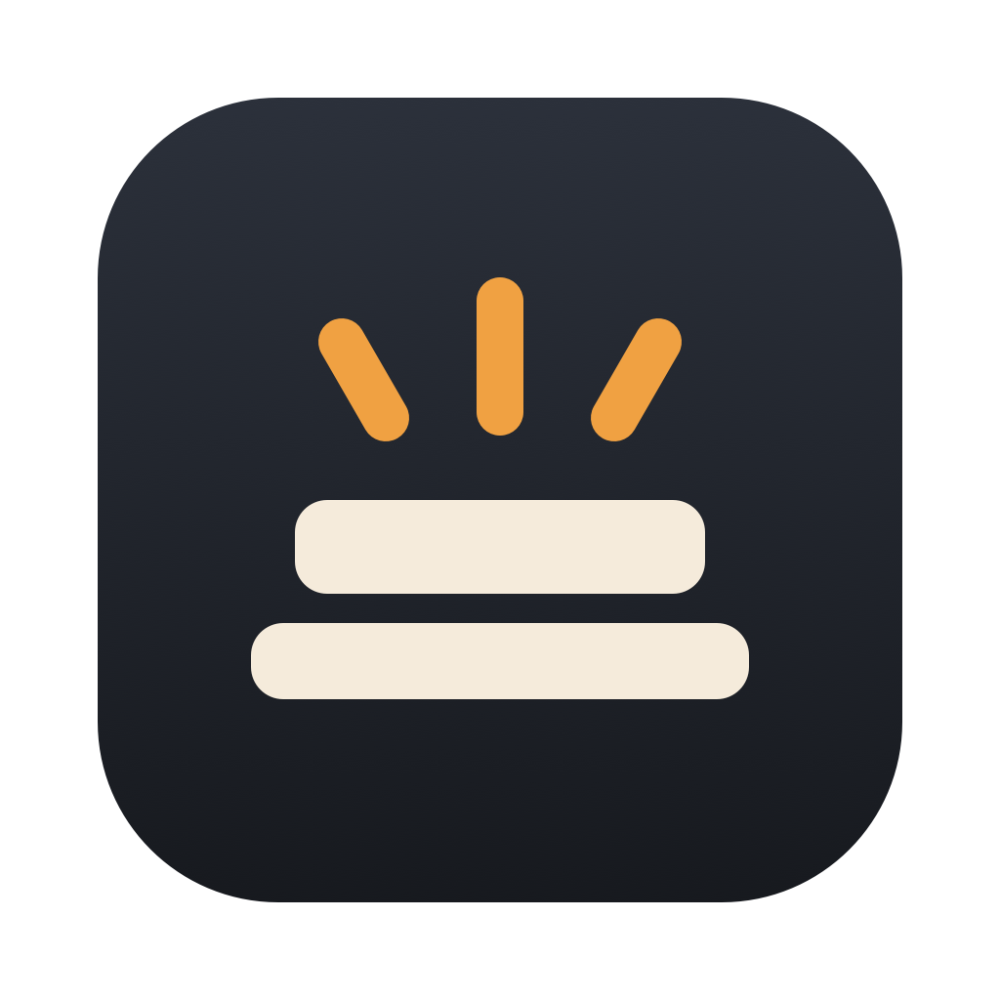

<p align="center"></p>

# AgentAwake

Keeps your Mac awake while AI agents work — even with the lid closed — and lets it sleep when they finish.
By [SyncEdge](https://syncedge.tech).

## Install

1. Download `AgentAwake-<version>.dmg` from the newest release.
2. Open it and double-click **AgentAwake**. It moves itself to Applications.
3. In the Welcome window, click **Set up** and enter your Mac password once.

AgentAwake checks for updates once a day and asks before installing.

### Homebrew

```sh
brew install --cask syncedge/tap/agentawake
```

Then open AgentAwake and click **Set up** as in step 3. The app updates itself, so `brew upgrade` skips it.
To remove it, first choose **Uninstall helper…** in the AgentAwake panel (it removes the parts Set up added
outside the app), then `brew uninstall --cask agentawake`. Tap: [SyncEdge/homebrew-tap](https://github.com/SyncEdge/homebrew-tap).

### Claude Code plugin

The plugin tells Claude, at the start of each session, to start long background jobs, `/loop` waits and background
agents so AgentAwake keeps the Mac awake until they finish. It needs the app installed; without it the plugin does nothing.
In Claude Code:

```
/plugin marketplace add SyncEdge/agentawake-releases
/plugin install agentawake@syncedge
```

Plugin files: [`claude-code/agentawake`](claude-code/agentawake). The app's **Connect agents…** window adds the same hook
without the plugin.

**0.9.x versions are time-limited betas.** Each one stops keeping the Mac awake on the date shown in its menu;
the next beta or 1.0 replaces it automatically.

Problems: **Report a problem…** in the AgentAwake menu, or support@syncedge.tech.
